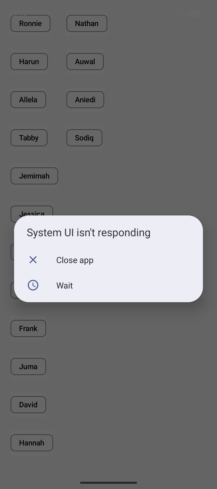

# Flow Column Example

An Android application demonstrating dynamic, responsive multi-column chip layouts in **Jetpack Compose** using the `FlowColumn` layout and Material 3 `FilterChip` components.

---

## 📱 Screenshots

| Portrait Mode | Landscape Mode |
| :---: | :---: |
|  |  |

---

## ✨ Features

- **Dynamic Flow Layout**: Demonstrates `FlowColumn` from `androidx.compose.foundation.layout` to flow elements top-to-bottom and automatically wrap items into subsequent columns when screen height boundaries are reached.
- **State-Hoisted Chip Selection**: Interactive `FilterChip` UI built with clean Jetpack Compose state hoisting (`isSelected`, `onSelectedChange`).
- **Material 3 Design System**: Integrates Material 3 color schemes and dynamic styling support.
- **Orientation Adaptive**: Automatically adapts content flow across various screen aspect ratios and orientations.

---

## 🛠️ Tech Stack & Requirements

- **Kotlin**: 2.1.0
- **Jetpack Compose**: BOM `2024.12.01` (Compose Material 3, Foundation Layout)
- **Android Gradle Plugin (AGP)**: 8.7.3
- **Gradle**: 8.11.1
- **Target SDK**: 35 (Android 15)
- **Compile SDK**: 36
- **Minimum SDK**: 26 (Android 8.0)
- **Java Version**: 17

---

## 📁 Project Structure

```
Flow-Column-Example/
├── app/
│   ├── src/main/java/com/starchild13/flowcolumnexample/
│   │   ├── MainActivity.kt        # Main Activity & FlowColumn composables
│   │   └── ui/theme/              # Material 3 Color, Theme, & Typography
│   └── build.gradle               # App module dependencies & configuration
├── screenshots/                   # Screenshots for documentation
├── build.gradle                   # Top-level plugin versions
└── settings.gradle                # Repository & module settings
```

---

## 🚀 Getting Started

### Prerequisites
- [Android Studio](https://developer.android.com/studio) (Ladybug or newer)
- JDK 17 or higher

### Building & Running

1. **Clone the repository:**
   ```bash
   git clone https://github.com/your-username/Flow-Column-Example.git
   cd Flow-Column-Example
   ```

2. **Build the project:**
   ```bash
   ./gradlew assembleDebug
   ```

3. **Run Unit Tests:**
   ```bash
   ./gradlew testDebugUnitTest
   ```

4. **Deploy to Device / Emulator:**
   Open the project in Android Studio, select your target device, and click **Run (Shift + F10)**.

---

## 📄 License

This project is open-source and available under the [MIT License](LICENSE).
